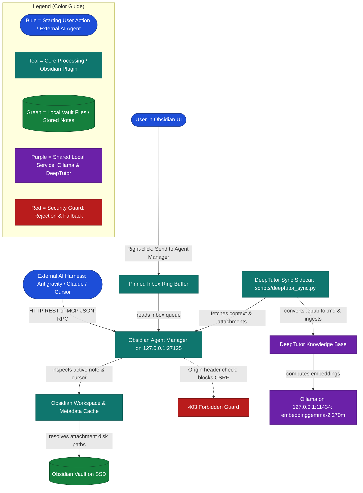

# Obsidian Agent Manager

[](https://github.com/Mostakim2005/obsidian-agent-manager/actions/workflows/build.yml)
[](LICENSE)

A lightweight, zero-binary-bloat Obsidian plugin and sidecar system designed for workstations that need powerful AI agent integration without memory exhaustion or CPU lag.

Instead of bundling heavy agent binaries or bloated language runtimes inside Obsidian, **Obsidian Agent Manager** runs a tiny (<100 KB) in-process TypeScript localhost bridge (`127.0.0.1:27125`) inside Obsidian. It connects seamlessly to **any external agentic harness** (Google Antigravity, Claude Code, Gemini CLI, Cursor, Codex) and **[DeepTutor](https://github.com/HKUDS/DeepTutor)** via a **single shared local Ollama embedding service** running Google's [`embeddinggemma-2:270m`](https://ollama.com/library/embeddinggemma-2).

---

## Architecture Overview



---

## Core Capabilities

1. **Live Workspace Context (`GET /context`):**
   - Active note (vault-relative and absolute disk paths)
   - Open editor tabs and active tab indicator
   - Cursor line/column and active text selection
   - Active Markdown heading above the cursor
   - Global Obsidian search query and matching file paths

2. **Graph Traversal & Resolved Attachments (`GET /note/graph`, `GET /context/attachments`):**
   - Resolves outgoing `[[wikilinks]]`, incoming backlinks, and embedded attachments (`.png`, `.pdf`, `.epub`) to absolute disk paths so multimodal agent harnesses can open them directly.

3. **Undo-Safe In-Place Editing (`POST /edit`):**
   - Applies edits to active notes using CodeMirror transactions (`editor.replaceRange` / `editor.replaceSelection`), ensuring `Ctrl+Z` undo history is preserved without corrupting notes. Background files are safely edited via `app.vault.process()`.

4. **Built-in Streamable HTTP MCP Server (`POST /mcp`):**
   - Implements Model Context Protocol (JSON-RPC 2.0 `initialize`, `tools/list`, `tools/call`) directly inside the plugin. Antigravity, Claude Code, and Cursor connect natively with zero extra bridge processes.

5. **Right-Click Context Menu & Pinned Inbox:**
   - Right-click text or notes in the editor: **"Send selection to Agent Manager"**.
   - Right-click files/attachments in the file explorer: **"Pin file/attachment to Agent Manager"**.
   - Pushes items to an in-memory ring buffer inbox (`GET /inbox`, `POST /inbox/clear`).

6. **DeepTutor Knowledge Base & EPUB Ingestion Helper:**
   - Python automation script (`scripts/deeptutor_sync.py`) parses `.epub` books into clean chaptered Markdown and indexes notes/attachments into [DeepTutor](https://github.com/HKUDS/DeepTutor) using local embeddings.

---

## Client MCP Configuration

Add this entry to your agent harness configuration (e.g., Antigravity `mcp_servers.json`, Claude Code `~/.claude.json`, or Cursor Settings):

```json
{
  "mcpServers": {
    "obsidian-agent-manager": {
      "type": "http",
      "url": "http://127.0.0.1:27125/mcp",
      "headers": {
        "Authorization": "Bearer <YOUR_TOKEN>"
      }
    }
  }
}
```

*(Retrieve or regenerate your API token directly from Obsidian Settings -> Obsidian Agent Manager Settings).*

---

## Shared Embedding Service (`embeddinggemma-2:270m`)

To prevent workstation freezes and keep RAM under 200 MB, both DeepTutor and vault RAG share a single CPU-throttled Ollama embedding model:

1. **Configure CPU throttling & persistent environment variables:**
   ```powershell
   [System.Environment]::SetEnvironmentVariable("OLLAMA_NUM_THREAD", "4", "User")
   [System.Environment]::SetEnvironmentVariable("OLLAMA_KEEP_ALIVE", "5m", "User")
   [System.Environment]::SetEnvironmentVariable("OLLAMA_HOST", "127.0.0.1:11434", "User")
   ```

2. **Pull the model in Ollama:**
   ```bash
   ollama pull embeddinggemma-2:270m
   ```

3. **Verify the 768-dimension endpoint:**
   ```bash
   curl -s http://127.0.0.1:11434/v1/embeddings \
     -H "Content-Type: application/json" \
     -d '{"model":"embeddinggemma-2:270m","input":"test obsidian agent manager"}'
   ```

4. **Apply DeepTutor configuration:**
   ```bash
   deeptutor config apply scripts/deeptutor_setup.json --check
   deeptutor config apply scripts/deeptutor_setup.json
   ```

Or run the automated helper:
```powershell
powershell -ExecutionPolicy Bypass -File scripts/setup_embedding_gemma.ps1
```

---

## DeepTutor & EPUB Ingestion

1. Pin notes, PDFs, or EPUB attachments in Obsidian via the right-click menu.
2. Ingest pinned items into a DeepTutor Knowledge Base:
   ```bash
   python scripts/deeptutor_sync.py --kb research-study --from-inbox
   ```

---

## Security Model

- **Strict Loopback Binding:** The server listens strictly on `127.0.0.1` and never exposes interfaces to the local network or external interfaces.
- **CSRF / DNS-Rebinding Protection:** Any incoming HTTP request with a browser `Origin` header is rejected immediately with HTTP 403 Forbidden.
- **Timing-Safe Authentication:** All endpoints (except `/health`) require `Authorization: Bearer <token>` validated using `crypto.timingSafeEqual` to prevent timing side-channel attacks.

---

## Documentation

Full architectural documentation and engineering standards are available in the `docs/` suite:
- [`docs/PRODUCT.md`](docs/PRODUCT.md) — User intent, active feature map, and merge wishlist.
- [`docs/ARCHITECTURE.md`](docs/ARCHITECTURE.md) — System map, subsystem mechanics, and tech stack rationale.
- [`docs/DECISIONS_AND_TRAPS.md`](docs/DECISIONS_AND_TRAPS.md) — Architectural pivots and protected engineering traps.
- [`docs/VISUAL_LOG.md`](docs/VISUAL_LOG.md) — Color-coded Obsidian-compatible Mermaid flowcharts.

---

## License

Licensed under the **[PolyForm Noncommercial License 1.0.0](LICENSE)**.
Third-party credits and open-source licenses are detailed in [`THIRD_PARTY_NOTICES.md`](THIRD_PARTY_NOTICES.md).
