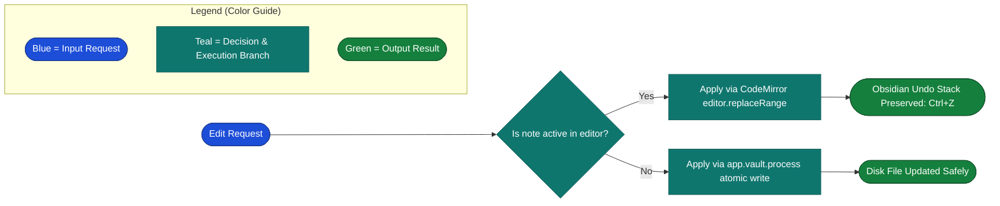

# System Architecture (`ARCHITECTURE.md`)
> **1-Line Summary:** Architectural overview of Obsidian Agent Manager, illustrating how external agent harnesses, local embeddings, DeepTutor, and Obsidian's workspace state communicate safely.

## 1. High-Level Visual System Map
* **Plain-English Overview:** External AI harnesses (such as Google Antigravity, Claude Code, or Cursor) connect to Obsidian through an in-process loopback HTTP server and Streamable HTTP MCP endpoint. When the user interacts with notes or right-clicks attachments, the plugin captures live editor state and resolves disk paths, while DeepTutor and local RAG sidecars share a single CPU-throttled Ollama embedding service running `embeddinggemma-2:270m`.

```mermaid
flowchart TB
    %% Color Definitions (Obsidian & GitHub compatible)
    classDef startNode fill:#1d4ed8,stroke:#1e3a8a,color:#ffffff
    classDef processNode fill:#0f766e,stroke:#115e59,color:#ffffff
    classDef outputNode fill:#15803d,stroke:#14532d,color:#ffffff
    classDef serviceNode fill:#6b21a8,stroke:#581c87,color:#ffffff
    classDef trapNode fill:#b91c1c,stroke:#7f1d1d,color:#ffffff

    Harness([External AI Harness: Antigravity / Claude Code / Cursor]):::startNode -->|HTTP REST or MCP JSON-RPC| Server[Obsidian Agent Manager Server on 127.0.0.1:27125]:::processNode
    Server -->|inspects active note & selection| Workspace[Obsidian Workspace & Metadata Cache]:::processNode
    Workspace -->|resolves attachment disk paths| Vault[(Obsidian Vault on SSD)]:::outputNode

    User([User in Obsidian UI]):::startNode -->|Right-click: Send to Agent Manager| Menus[Pinned Inbox Ring Buffer]:::processNode
    Menus -->|reads inbox queue| Server

    Sidecar[DeepTutor Sync Sidecar: scripts/deeptutor_sync.py]:::processNode -->|fetches context & attachments| Server
    Sidecar -->|converts .epub to .md & ingests| DT[DeepTutor Knowledge Base]:::serviceNode
    DT -->|computes embeddings| Ollama[Ollama on 127.0.0.1:11434: embeddinggemma-2:270m]:::serviceNode

    Server -.->|Origin header check: blocks CSRF| SecurityGuard[403 Forbidden Guard]:::trapNode

    subgraph Legend["Legend (Color Guide)"]
        L1([Blue = Starting User Action / External AI Agent]):::startNode
        L2[Teal = Core Processing / Obsidian Plugin]:-::processNode
        L3[(Green = Local Vault Files / Stored Notes)]:::outputNode
        L4[Purple = Shared Local Service: Ollama & DeepTutor]:::serviceNode
        L5[Red = Security Guard: Rejection & Fallback]:::trapNode
    end
```

## 2. Tech Stack & Why We Chose It

| Layer | Tool / Library | Plain-English Reason Why |
| :--- | :--- | :--- |
| **Plugin Host** | Obsidian Plugin API (`obsidian`) | Direct access to active leaf views, CodeMirror editor instances, and metadata cache. |
| **Bundler** | `esbuild` | Sub-second builds producing a clean, single-file CommonJS `main.js` (<100 KB) with zero bundled binaries. |
| **Protocol** | Model Context Protocol (MCP) Streamable HTTP + REST | Allows Antigravity, Claude Code, and Cursor to call tools natively over standard JSON-RPC 2.0 without separate bridge processes. |
| **Embeddings** | Ollama (`embeddinggemma-2:270m`) | Highly compact 768-dimensional model running on CPU (`OLLAMA_NUM_THREAD=4`) sharing memory between DeepTutor and vault RAG. |
| **RAG Engine** | DeepTutor v1.7.0 (`HKUDS/DeepTutor`) | Hybrid vector + BM25 keyword retrieval over research notes, PDFs, and converted EPUB chapters. |
| **EPUB Pipeline** | `ebooklib` + `beautifulsoup4` | Parses `.epub` archives into structured chaptered Markdown with clean headings before ingestion. |

## 3. Core Subsystems & Mechanics

### [SUBSYSTEM: Undo-Safe-Editor-Transactions] | Aliases: editor engine, codemirror, transactions, replace selection
> **1-Line Summary:** Applies note updates via active CodeMirror transactions when editing the active note, ensuring the user's `Ctrl+Z` history remains intact.
* **How It Works (Plain English):** When an agent requests an edit (`/edit` or `obsidian_edit_note`), the plugin checks if the target file is currently focused in an open Markdown view. If active, it uses `editor.replaceRange()` or `editor.replaceSelection()`, registering the edit into Obsidian's undo stack. For background notes, it uses `app.vault.process()` for atomic file modification.
* **Data Flow Diagram:**



* **Code Anchors (Grep Targets):**
  * `plugin/src/editor.ts` -> `applyEdit`, `replaceSelectionUndoSafe`, `replaceLinesUndoSafe`

---

### [SUBSYSTEM: Multi-Vault-Discovery] | Aliases: discovery file, vaults.json, multi-vault
> **1-Line Summary:** Maintains an active directory registry in `~/.obsidian-agent-manager/vaults.json` so CLI tools can find running vault ports and auth tokens automatically.
* **How It Works (Plain English):** On startup, `BridgeServer` writes its port, token, vault name, and absolute vault path to `~/.obsidian-agent-manager/vaults.json`. On shutdown, it cleanly unregisters its entry.
* **Code Anchors (Grep Targets):**
  * `plugin/src/server.ts` -> `updateDiscovery`, `discoveryFile`

---

### [SUBSYSTEM: DeepTutor-EPUB-Sync] | Aliases: epub converter, deeptutor sync, staging folder
> **1-Line Summary:** Ingests research PDFs, Markdown notes, and converted EPUBs into DeepTutor hybrid knowledge bases using the shared local embedding service.
* **How It Works (Plain English):** `scripts/deeptutor_sync.py` reads attachments from the bridge server, converts any `.epub` files into Markdown chapters in `.obsidian-agent-manager-staging/`, and executes `deeptutor kb add` using `embeddinggemma-2:270m`.
* **Code Anchors (Grep Targets):**
  * `scripts/deeptutor_sync.py` -> `convert_epub_to_markdown`, `ingest_into_deeptutor`
  * `scripts/deeptutor_setup.json` -> `embedding`
