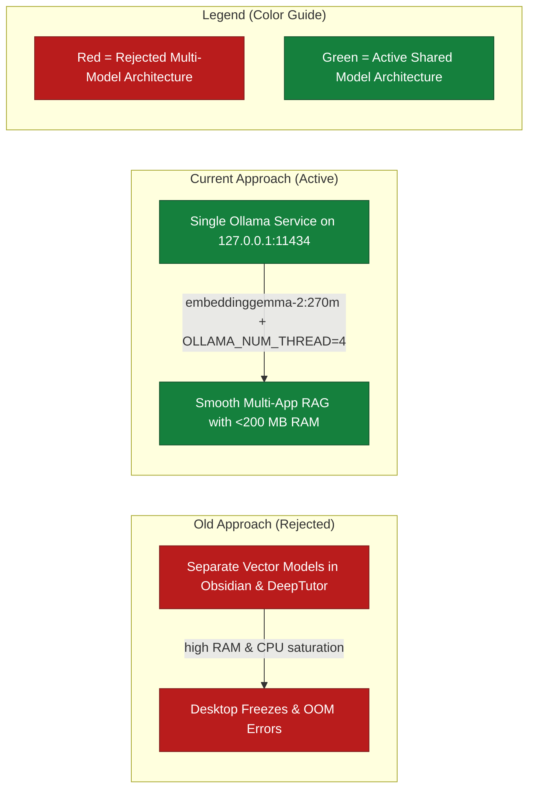

# Architectural Decisions, Pivots & Landmines (`DECISIONS_AND_TRAPS.md`)
> **1-Line Summary:** Records why key architectural choices were made, what approaches were rejected, and non-obvious engineering landmines that must never be broken.

## 1. Architectural Decisions & Pivot History

### [DECISION: Single-Shared-Embedding-Model] | Aliases: embeddinggemma-2, nomic-embed-text, shared embeddings
> **1-Line Summary:** Standardized on Google's `embeddinggemma-2:270m` (768 dimensions) in Ollama for both DeepTutor and local note RAG rather than running separate models.
* **Decision Maker:** `[DECIDED BY: HUMAN]`
* **Original User Intention:** Prevent memory exhaustion and CPU lag on a Ryzen 5 5600G (16 GB RAM) workstation by sharing a single lightweight embedding model across all tools.
* **Options Considered:**
  * **Option A (Rejected):** Embedding models bundled inside Obsidian plugins or running separate models for Obsidian Copilot and DeepTutor, which consumed excessive RAM (>2 GB) and saturated CPU threads during indexing.
  * **Option B (Chosen):** Centralizing on Ollama's OpenAI-compatible `/v1/embeddings` endpoint with `embeddinggemma-2:270m`, throttled to 4 CPU threads (`OLLAMA_NUM_THREAD=4`) and 5-minute memory unloading (`OLLAMA_KEEP_ALIVE=5m`).
* **Plain-English Summary of Pivot:** Instead of each app managing its own vector models, one lightweight service handles all embedding requests cleanly.
* **Visual Pivot Map (What Failed vs. What Works):**

* **Code Anchors (Grep Targets):**
  * `scripts/deeptutor_setup.json` -> `embedding.model`
  * `scripts/setup_embedding_gemma.ps1` -> `OLLAMA_NUM_THREAD`

---

### [DECISION: Cloud-First-GitHub-Actions-Compilation] | Aliases: lean disk, no local node_modules, gh actions build
> **1-Line Summary:** Compile production bundles in GitHub Actions CI rather than requiring large local `node_modules` on the workstation.
* **Decision Maker:** `[DECIDED BY: HUMAN]`
* **Original User Intention:** Avoid bloating the user's local disk with hundreds of megabytes of npm dependencies.
* **Options Considered:**
  * **Option A (Rejected):** Forcing full local `npm install` and local compilation before every commit.
  * **Option B (Chosen):** Setting up GitHub Actions (`.github/workflows/build.yml` and `.github/workflows/release.yml`) to run compilation, type-checking, and release packaging in the cloud on push.
* **Plain-English Summary of Pivot:** The local repository remains lean and pristine, while GitHub Actions handles the heavy node dependencies and builds `main.js`.
* **Code Anchors (Grep Targets):**
  * `.github/workflows/build.yml` -> `build`
  * `.github/workflows/release.yml` -> `release`

---

## 2. Do-Not-Touch Engineering Landmines (Traps)

### [TRAP: Loopback-Binding-And-Origin-Rejection] | Aliases: security trap, dns rebinding, origin check, 127.0.0.1
> **1-Line Summary:** The server must strictly listen on `127.0.0.1` and reject any request with an `Origin` header with HTTP 403.
* **Strict Rule:** **NEVER** bind `BridgeServer` to `0.0.0.0` or allow requests with browser `Origin` headers to bypass the 403 guard.
* **Why This Trap Exists (Plain English):** Malicious websites in the user's web browser can perform DNS rebinding or CSRF attacks against `localhost`. If `0.0.0.0` or open origins were permitted, any web tab could read the user's private Obsidian vault notes and execute file edits.
* **Protected Code Anchors (Grep Targets):**
  * `plugin/src/server.ts` -> `handleRequest`, `server.listen(port, "127.0.0.1")`

---

### [TRAP: DeepTutor-Single-Turn-Owner] | Aliases: deeptutor trap, concurrent turns, lock collision
> **1-Line Summary:** Never run interactive CLI chat turns (`deeptutor run chat`) against the same `DEEPTUTOR_HOME` while the backend server (`127.0.0.1:8001`) is running.
* **Strict Rule:** **NEVER** trigger concurrent CLI chat sessions while the background DeepTutor API server owns the active session.
* **Why This Trap Exists (Plain English):** DeepTutor maintains internal state and sqlite/sqlite-vec locks per `DEEPTUTOR_HOME`. Starting a simultaneous interactive chat turn corrupts the active session state. Live sessions must interact exclusively via DeepTutor's HTTP API (`127.0.0.1:8001`), reserving the CLI for batch operations like `deeptutor kb add`.
* **Protected Code Anchors (Grep Targets):**
  * `scripts/deeptutor_sync.py` -> `ingest_into_deeptutor`

---

### [TRAP: Undo-Stack-Preservation] | Aliases: editor undo, ctrl+z, codemirror replaceRange
> **1-Line Summary:** When editing the active note, always mutate through the active `MarkdownView.editor` rather than writing directly to disk.
* **Strict Rule:** **NEVER** overwrite an active note using file system writes (`app.vault.adapter.write` or Node `fs`) when an open editor instance exists.
* **Why This Trap Exists (Plain English):** Obsidian tracks undo history in memory via CodeMirror transactions. Overwriting the file on disk bypasses CodeMirror, wiping out the user's undo/redo history (`Ctrl+Z`) and potentially creating race conditions with Obsidian's auto-save buffer.
* **Protected Code Anchors (Grep Targets):**
  * `plugin/src/editor.ts` -> `replaceSelectionUndoSafe`, `replaceLinesUndoSafe`

---

### [TRAP: Vault-Path-Traversal-Prevention] | Aliases: path traversal, dot dot, security, normalizeSafeVaultPath
> **1-Line Summary:** All note paths received from REST endpoints or MCP arguments must pass through `normalizeSafeVaultPath` before touch.
* **Strict Rule:** **NEVER** accept unvalidated file paths containing `..` or leading slashes when creating or writing notes.
* **Why This Trap Exists (Plain English):** Unchecked path parameters allow an agent or rogue client to traverse out of the vault boundary (e.g., `../../Windows/System32` or `../../.ssh`), risking arbitrary file overwrites on the host OS.
* **Protected Code Anchors (Grep Targets):**
  * `plugin/src/security.ts` -> `normalizeSafeVaultPath`
  * `plugin/src/editor.ts` -> `createNote`
