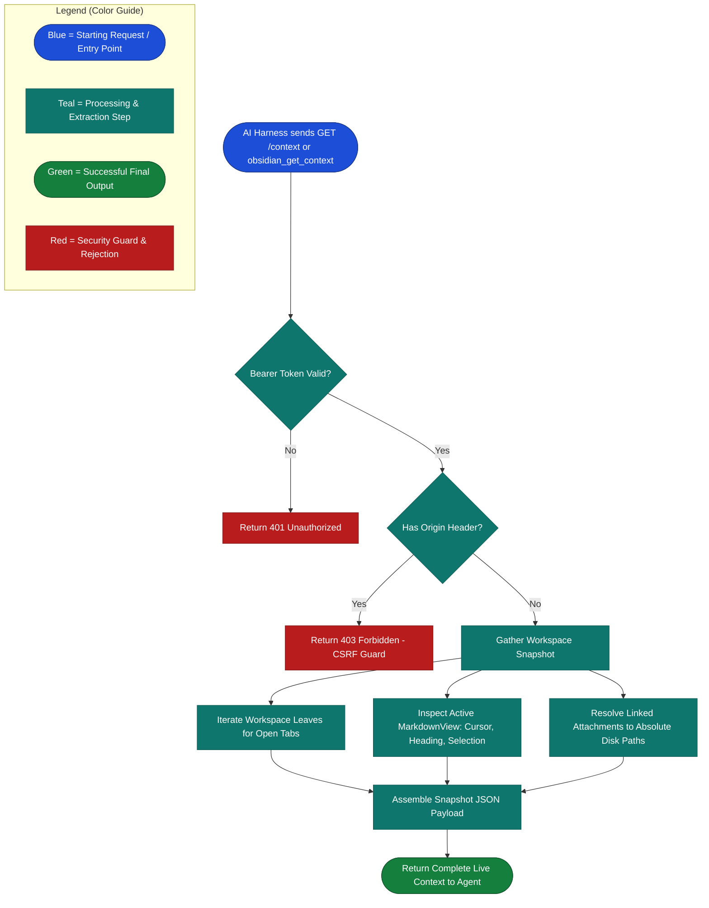
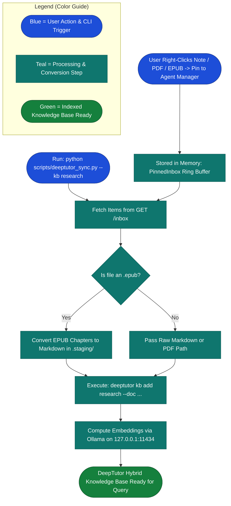
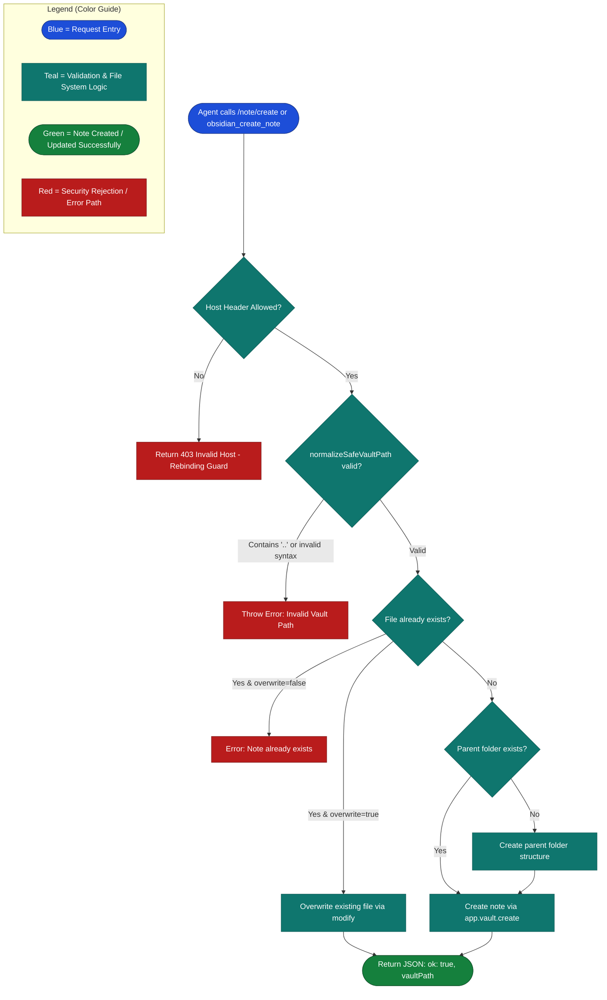

# Visual Feature & Change Log (`VISUAL_LOG.md`)
> **1-Line Summary:** Plain-English, color-coded Obsidian-compatible Mermaid flowcharts explaining how each major flow in Obsidian Agent Manager operates end to end.

## Feature & Change Flowcharts

### [VISUAL: Agent-Context-And-Inspection-Flow] | Aliases: get context, mcp context, active note inspection
> **1-Line Summary:** How an external AI harness queries live Obsidian workspace state and receives resolved attachments and cursor context.

* **Plain-English Walkthrough:** When an agent queries `/context` or calls the `obsidian_get_context` MCP tool, the plugin inspects the active editor leaf, extracts the cursor line, resolves the active markdown heading, gathers all open editor tabs, and collects file paths. If attachments (images, PDFs, EPUBs) are linked, it resolves them to absolute file paths on disk so the external agent can inspect them directly.

* **Code Anchors (Grep Targets):**
  * `plugin/src/server.ts` -> `handleRequest`
  * `plugin/src/context.ts` -> `getWorkspaceSnapshot`, `getActiveHeading`
  * `plugin/src/graph.ts` -> `getActiveAttachments`

---

### [VISUAL: EPUB-To-DeepTutor-RAG-Ingestion-Flow] | Aliases: epub conversion, deeptutor sync, hybrid rag ingestion
> **1-Line Summary:** How pinned items and EPUB attachments are converted to Markdown and ingested into DeepTutor knowledge bases.

* **Plain-English Walkthrough:** The user right-clicks a note, PDF, or EPUB in Obsidian to pin it to the Agent Manager inbox. Running `python scripts/deeptutor_sync.py --kb <kb-name>` fetches the pinned items over localhost. If any file is an `.epub`, it extracts each chapter into a clean `.md` file with proper headings in the staging folder. It then calls `deeptutor kb add`, which embeds all content through Ollama (`embeddinggemma-2:270m`) using 4 CPU threads.

* **Code Anchors (Grep Targets):**
  * `plugin/src/menus.ts` -> `attachFileMenu`, `PinnedInbox`
  * `scripts/deeptutor_sync.py` -> `convert_epub_to_markdown`, `ingest_into_deeptutor`
  * `scripts/deeptutor_setup.json` -> `embedding`

---

### [VISUAL: Safe-Note-Creation-And-Path-Validation-Flow] | Aliases: create note flow, path validation, traversal check
> **1-Line Summary:** How note creation requests are validated against path traversal before safely creating folders and files in the vault.

* **Plain-English Walkthrough:** When an agent invokes `/note/create` or `obsidian_create_note`, the target path passes through `normalizeSafeVaultPath()`. If it contains `..` or leading slashes, the request fails with a security error. If valid, parent folders are automatically verified or created, and the note is safely written without overwriting existing files unless explicitly flagged.

* **Code Anchors (Grep Targets):**
  * `plugin/src/security.ts` -> `normalizeSafeVaultPath`, `isAllowedHost`
  * `plugin/src/editor.ts` -> `createNote`
  * `plugin/src/server.ts` -> `handleRequest`
